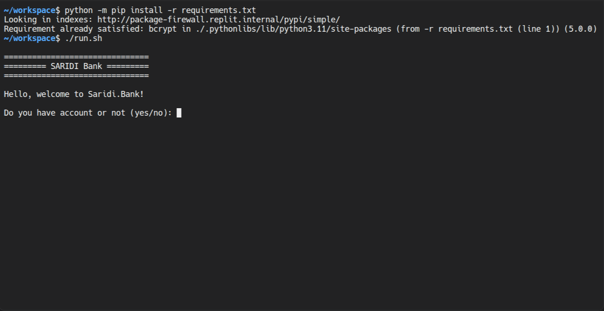
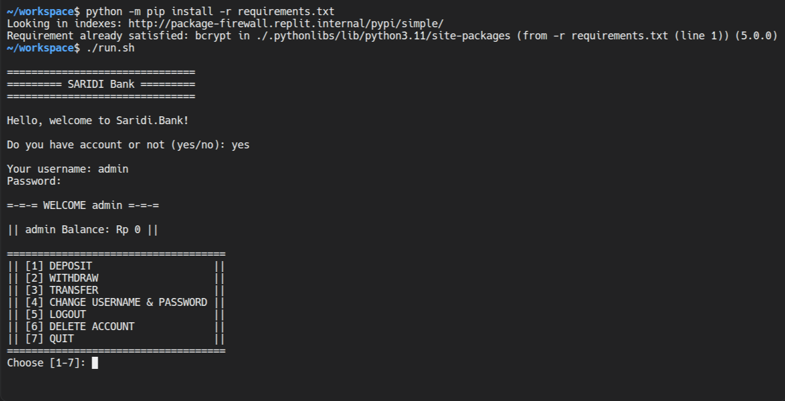
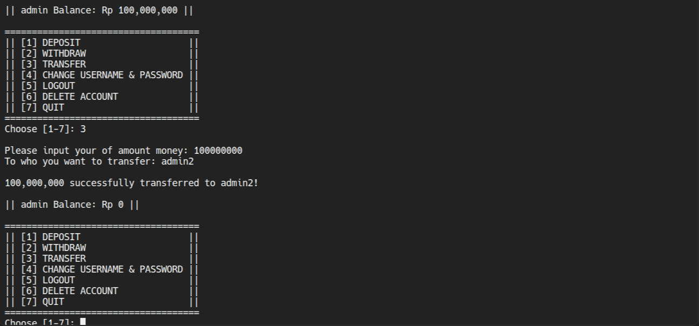

# Saridi Bank Simulator

[](https://github.com/Saridi-The-Pro/Saridi-Bank-Simulator/actions/workflows/ci-test.yml)

A local CLI banking simulator created as a personal learning project for Python backend development, SQLite databases, transaction logic, and application security.

> Disclaimer: This project uses fictional credits only. It is not a real bank, payment service, or financial product.

## Current Version
v0.2.1 - Database Unit Testing & Automated Pipeline

## Screenshots

### Main Menu


### Login


### Banking Operations



## Current Features
- Account registration and login
- SQLite-based balance storage
- Password hashing with bcrypt
- Hidden password input using `getpass()`
- Deposit and withdrawals
- Transfers between accounts
- Username and password changes
- Account deletion with validation
- Transaction and balance limits
- Input validation, whitespace sanitization, and basic SQL injection protection
- Comprehensive database unit testing suite (including concurrency and error scenarios)
- Automated cross-platform CI/CD testing and executable release workflows

## Planned Features
- Transaction history for deposits, withdrawals, and transfers
- Unique account numbers
- Multi-currency support
- Maintenance Panel for database diagnostics and error investigation
- Flask API and web interface

## Dependencies
- Python (3.11 - 3.14)
- bcrypt
Install the required dependencies using pip:
```bash
python -m pip install -r requirements.txt
```

## Important Warnings
- **Account Deletion**: The delete_user() function permanently deletes the selected account from the database. Make sure you select the correct account before proceeding.
- **Table Deletion**: The delete_table() function deletes the entire users table, including all account records and balances stored in it. This operation cannot be undone through the application. Use this function only when intentionally resetting or maintaining the database and back up any important data beforehand.

## How to Run the Program
Choose the method that works best for your operating system:

### Method 1: Using the Shortcut Launcher (Recommended)
*   **Windows Users:** Double-click the `run.bat` file.
*   **macOS/Linux Users:** Open a terminal in this project folder and run:
    ```bash
    chmod +x run.sh
    ./run.sh
    ```
    Alternatively, run the script using Bash without changing its executable permission:
    ```bash
    bash run.sh
    ```

### Method 2: Manual Execution via Terminal or Command Prompt
1. Open **Terminal** (macOS/Linux) or **Command Prompt** (Windows) inside the project folder.
2. Run the application using the appropriate command for your operating system:
   **Windows:**
   ```bash
   python bank.py
   ```
   **macOS/Linux:**
   ```bash
   python3 bank.py
   ```

### Method 3: Running Pre-built Executables (No Python Required)
If you don't have Python installed, you can download standalone binaries directly from the **[Releases](https://github.com/Saridi-The-Pro/Saridi-Bank-Simulator/releases)** page:
* **Windows Users:** Download `bank.exe` and double-click to run.
* **Linux Users:** Download `bank`, grant execution permissions, and run in terminal:
  ```bash
  chmod +x bank
  ./bank
  ```
* **macOS Users:** Please use Method 1 or Method 2 (running via Python 3 source code) due to Apple Gatekeeper binary signing requirements.

## License & Copyright
> Copyright (c) 2026 Saridi. All rights reserved.
> 
> **This project is proprietary. Unauthorized copying, modification, or distribution of this code, in whole or in part, is prohibited without permission from the copyright holder.**
